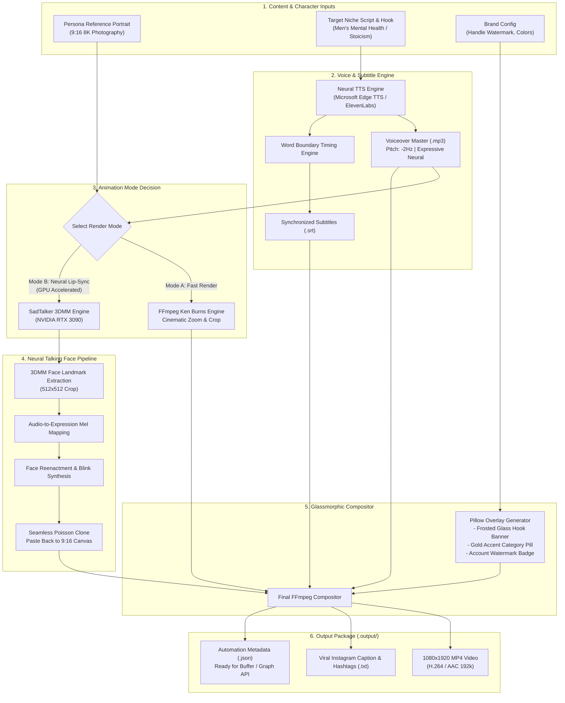

# SaacheeVator 🎥✨

> **Autonomous AI Influencer Video Generation Engine for Instagram Reels, Shorts & TikTok**  
> Focused on Men's Mental Health, Stoic Discipline, and High-Performance Mindset.

---

## 📌 Overview

**SaacheeVator** is an automated video production pipeline that converts high-fidelity photorealistic AI persona portraits into engaging, monetizable vertical short-form videos (9:16 format).

The engine pairs an empathetic, high-value female influencer avatar with psychologically resonant hooks, expressive neural voiceovers, GPU-accelerated lip-sync animation, and modern glassmorphic overlays.

---

## 🏗️ Architecture & Decision-Making Flow

The following diagram outlines the end-to-end processing pipeline, from prompt ideation to the final post-ready video package:



---

## 🧠 Decision-Making Logic

| Stage | Decision Point | Criteria | Selected Implementation |
| :--- | :--- | :--- | :--- |
| **Identity** | Static vs. Dynamic Persona | Consistency across Reels | Fixed high-res base portrait seeded with warm, confident expressions. |
| **Voice** | Robotic vs. Conversational | Viewer retention | `en-IN-NeerjaExpressiveNeural` / `en-US-AvaMultilingualNeural` tuned at `-2Hz` pitch for grounded empathy. |
| **Visual Animation** | Ken Burns vs. Full Lip-Sync | Compute & Production Speed | **Hybrid**: Flag-driven `--lip-sync` for talking-head advice; fast Ken Burns zoom for b-roll fit checks. |
| **Graphic Overlay** | Ad-hoc text vs. Glassmorphic Cards | Visual prestige | Semi-transparent rounded dark cards with subtle borders and gold category badges (`DAILY REMINDER`). |
| **Subtitles** | Manual vs. Automated | Turnaround time | Direct millisecond timestamp extraction from audio boundaries with Libass outline burn-in. |

---

## ⚡ Hardware & Environment Specifications

- **Tested Hardware**: NVIDIA GeForce RTX 3090 (24GB VRAM)
- **CUDA Runtime**: CUDA 12.4 / Driver 580.x
- **Python**: 3.11+
- **Video Tools**: FFmpeg 7.0+ with Libass & FreeType support

---

## 🚀 Quickstart Guide

### 1. Clone the Repository
```bash
git clone https://github.com/faizaliqbaal/SaacheeVator.git
cd SaacheeVator
```

### 2. Setup Virtual Environment
```bash
python3.11 -m venv sadtalker_env
source sadtalker_env/bin/activate

# Install PyTorch with CUDA 12.4
pip install torch torchvision torchaudio --index-url https://download.pytorch.org/whl/cu124

# Install audio/video & neural reenactment requirements
pip install -r requirements.txt
```

### 3. Generate Video Packages

#### 🎙️ Option A: Talking Avatar Reel with Full Lip-Sync (GPU)
```bash
python3 generate_reels.py --index 0 --lip-sync --handle "@mindset.elevate"
```

#### ⚡ Option B: Batch Generation (Ken Burns Motion)
```bash
python3 generate_reels.py --batch --handle "@mindset.elevate"
```

---

## 📂 Project Structure

```
SaacheeVator/
├── assets/
│   ├── persona_empathy.jpg               # Empathetic listening portrait
│   ├── persona_fitness.jpg               # Morning gym & discipline portrait
│   └── persona_lifestyle.jpg             # Luxury cafe & lifestyle portrait
├── output/
│   ├── reel_01_silent_battles_talking.mp4 # Rendered talking avatar reel
│   ├── reel_01_silent_battles.mp4         # Ken Burns motion reel
│   ├── reel_01_silent_battles_caption.txt # Viral caption & tags
│   └── reel_01_silent_battles_meta.json   # Machine-readable metadata
├── SadTalker/                             # 3DMM Neural face reenactment engine
├── generate_reels.py                      # Master generation script
└── README.md                              # System documentation & architecture
```

---

## 💰 Monetization Pathways

1. **Reels Bonus & Creator Rewards**: Maximize completion rate with 3-second hook banners and word-by-word subtitles.
2. **Affiliate Integration**: Add bio links for recommended journals, fitness supplements, or fashion pieces.
3. **Sponsorships & Brand Deals**: Pitch lifestyle, productivity apps, and male grooming brands once reaching 10k+ followers.
4. **Digital Products**: Automated funnels driving traffic to mindset Notion templates or audio courses.

---

## 📄 License
MIT License. Built for autonomous creator workflows.
